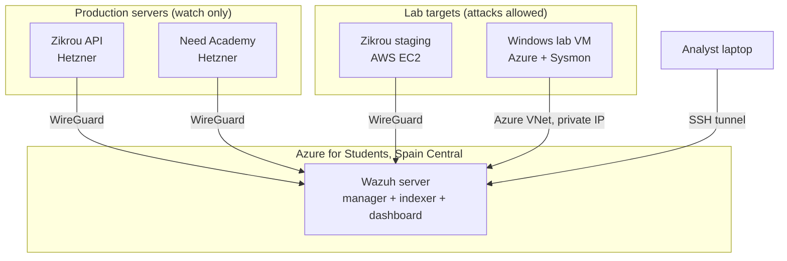

# Production Security Monitoring

A Security Operations Center that monitors two live production applications I build and run: **Zikrou** (mobile audio streaming, 6,000+ users) and **Need Academy** (English learning platform, 300 users). It covers log collection, detection engineering, alert triage and incident response on real traffic.

A staging server and lab machines are attacked on purpose to validate each detection before it is trusted in production. Production itself is only observed.

**Highlight:** detection testing on staging uncovered a critical account-takeover vulnerability in my own backend. It was exploited, fixed, retested and deployed to production the same day ([incident SOC-2026-001](incidents/reports/SOC-2026-001-reset-code-account-takeover.md)).

## Architecture



Design principles:

- **The SIEM never runs on a machine it monitors.** If a production server is compromised, the attacker cannot erase the evidence.
- **No SIEM port is exposed to the internet.** Agents reach the server through WireGuard, and the dashboard is only reachable through an SSH tunnel.
- **Production is observed, never attacked.** Attack simulations only target dedicated lab machines.
- **Defense in depth.** Cloud firewall, host firewall and hardened SSH are independent layers.

## Stack

| Layer | Tool |
|---|---|
| SIEM / XDR | Wazuh 4.14 (single-node) |
| Cloud | Microsoft Azure (Azure for Students) |
| OS | Ubuntu Server 24.04 LTS |
| Agent transport | WireGuard (hub and spoke) |
| Windows telemetry | Sysmon |
| Attack simulation | Atomic Red Team, Nmap, Hydra |
| Frameworks | MITRE ATT&CK, Sigma |

## Progress

| # | Phase | Status | Write-up |
|---|---|---|---|
| 1 | Cloud setup and server hardening | Done | [docs/01-cloud-setup-and-hardening.md](docs/01-cloud-setup-and-hardening.md) |
| 2 | Wazuh installation | Done | [docs/02-wazuh-installation.md](docs/02-wazuh-installation.md) |
| 3 | WireGuard network and agent enrollment | Done for staging, Zikrou production and Need Academy | [docs/03-wireguard-network.md](docs/03-wireguard-network.md) |
| 4 | Web logs and custom detections (Caddy) | Done on staging | [docs/04-web-logs-and-custom-detections.md](docs/04-web-logs-and-custom-detections.md) |
| 5 | API security logs and auth detections, critical vulnerability found and fixed | Done on staging | [docs/05-api-security-logs-and-reset-code-vulnerability.md](docs/05-api-security-logs-and-reset-code-vulnerability.md) |
| 6 | Production onboarding and first triage | Done | [docs/06-production-onboarding.md](docs/06-production-onboarding.md) |
| 7 | Incident response process and first incident reports | Done | [docs/07-incident-response.md](docs/07-incident-response.md) |
| 8 | Need Academy onboarding | Done | [docs/08-need-academy-onboarding.md](docs/08-need-academy-onboarding.md) |
| 9 | SSH detection engineering and automated response | Planned | |
| 10 | Windows lab with Sysmon and Atomic Red Team | Planned | |
| 11 | Baseline: one week of normal traffic | Planned | |
| 12 | Purple team scorecard | Planned | |
| 13 | Alert enrichment and notifications | Planned | |

## Repository layout

```
docs/          one write-up per phase
docs/images/   screenshots, one folder per phase
configs/       configuration files applied to the servers (no secrets)
incidents/     incident report template and closed incident reports
```

## Security note

This repository contains no secrets, keys, passwords, personal data or IP addresses of my own infrastructure and connections. Placeholders such as `<WAZUH_PUBLIC_IP>` are used instead. IP addresses of internet scanners appear in incident reports as indicators.
