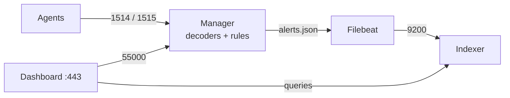
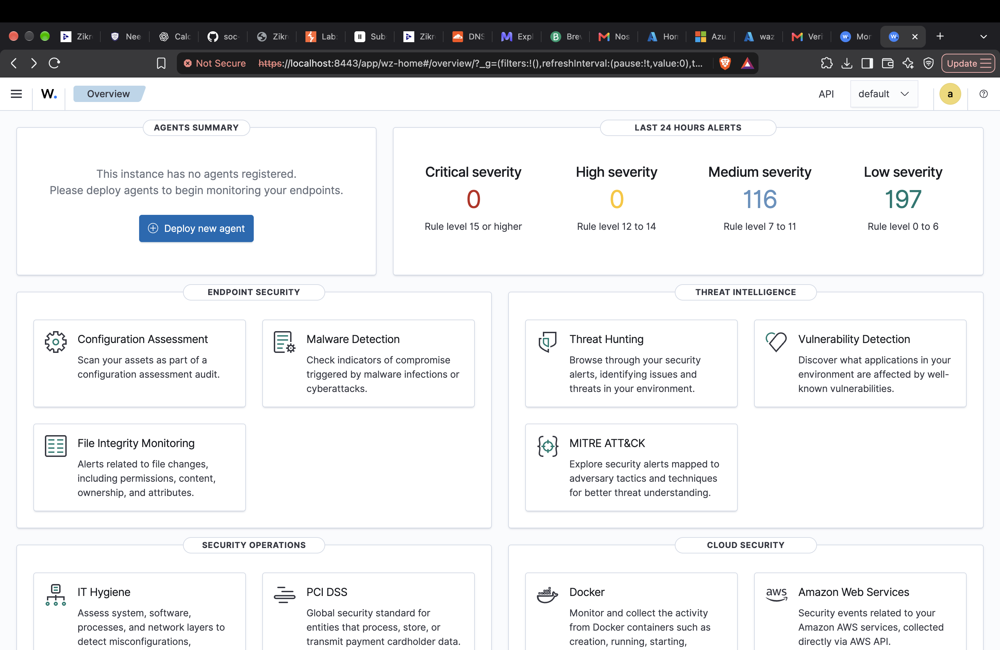
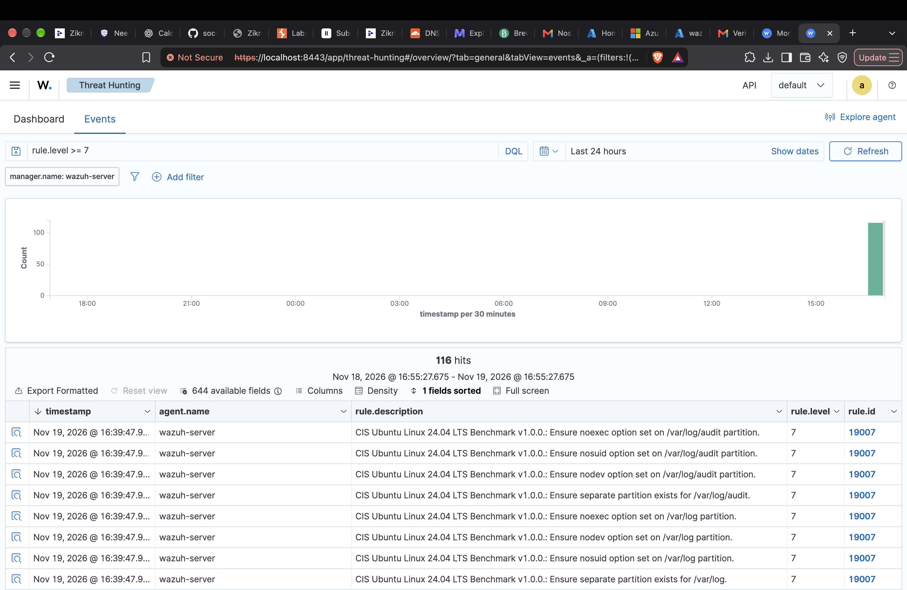

# 02: Wazuh installation

**Date:** 2026-11-19
**Goal:** install the Wazuh central components on the hardened server, reach the dashboard without exposing it to the internet, and read the first alerts.

## 1. What gets installed

Wazuh is three components. In a single-node deployment they all run on the same server.

| Component | Role | Port |
|---|---|---|
| **Wazuh indexer** | Stores and searches alerts (an OpenSearch fork) | 9200 |
| **Wazuh server (manager)** | Receives agent events, decodes them and applies detection rules | 1514 (events), 1515 (enrollment), 55000 (API) |
| **Wazuh dashboard** | Web interface for analysts | 443 |
| Filebeat | Ships the manager's alerts to the indexer | local only |



A single node is enough for a few agents. A larger SOC would split the indexer into a cluster for capacity and redundancy.

## 2. Installation

The official installation assistant installs the three components, generates TLS certificates for the traffic between them, and creates random passwords for every internal user.

```bash
tmux new -s wazuh
curl -sO https://packages.wazuh.com/4.14/wazuh-install.sh
sudo bash ./wazuh-install.sh -a
```

| Choice | Reason |
|---|---|
| Run inside `tmux` | The install takes several minutes. If the SSH session drops, `tmux` keeps it running, and `tmux attach -t wazuh` brings it back. A broken install leaves half-configured services. |
| Official script from `packages.wazuh.com` | Signed packages from the vendor's repository, the supported path. |
| `-a` (all-in-one) | Single-node deployment, sized for this lab. |

### Credentials

The assistant writes every generated password to `wazuh-install-files.tar` on the server. That file is the keys to the whole SIEM:

- The `admin` password was copied into my password manager.
- The archive is never copied into this repository. `.gitignore` excludes `*.tar`, `wazuh-install-files.tar` and `wazuh-passwords.txt`, in case one ends up in the folder by mistake.

## 3. Dashboard access through an SSH tunnel

The dashboard listens on TCP 443, but **443 is not opened** in the Azure NSG nor in UFW. The only inbound port on the server is SSH (and later WireGuard).

To reach the dashboard, I forward a local port through the existing SSH connection:

```bash
ssh -L 8443:localhost:443 wazuh
```

Then open `https://localhost:8443` on my laptop.

| Property | Effect |
|---|---|
| Nothing new exposed | Bots scanning the internet never see a Wazuh login page, so there is nothing to brute-force or exploit. |
| Same strong authentication | Reaching the dashboard requires the SSH key first, then the dashboard password. Two factors of different kinds. |
| Encrypted twice | SSH encrypts the tunnel, and the dashboard's own TLS runs inside it. |

The browser shows "Not secure" because the dashboard uses the self-signed certificate generated by the assistant. This is expected for a private lab: the connection is still encrypted, and the tunnel guarantees I am talking to my own server.

## 4. First alerts: the SIEM watches itself

The manager also runs a local agent (ID `000`), so the server monitors itself from the first minute. Before any other agent was connected, the dashboard already showed alerts:



**116 medium and 197 low alerts in 24 hours, with no attack at all.** Where do they come from?

Most of the medium alerts are **rule 19007**, produced by the **SCA** module (Security Configuration Assessment). SCA checks the system against the **CIS Benchmark for Ubuntu 24.04**, a public list of hardening recommendations:

| Rule | Meaning | Level |
|---|---|---|
| 19003 | Scan summary: the overall score is below a threshold | Depends on the score |
| 19007 | One check **failed** | 7 |
| 19008 | One check **passed** | 3 |



### Triage of the failures

These alerts are **true positives** (the checks really fail) but not attacks. They describe configuration, so the analyst decides for each one: fix it, or accept and document the risk.

| Example failure | Decision | Reason |
|---|---|---|
| Separate partition for `/var/log` and `/var/log/audit` | **Accept** | A cloud VM has a single managed disk. Repartitioning brings little here; disk usage is watched instead. |
| `noexec`, `nodev`, `nosuid` options on those partitions | **Accept** | Depends on the separate partitions above. |
| SSH and firewall checks | **Already handled** | Done in phase 01 (key-only SSH, no root login, deny by default). |

**Lesson:** a fresh SIEM is noisy before any attack happens. Knowing where the baseline noise comes from is what makes a real attack stand out later. This is also why the first searches use a level filter (`rule.level >= 7`).

## 5. Resulting exposure

| Port | Service | Reachable from the internet? |
|---|---|---|
| 22/tcp | SSH (key only) | Yes, by design |
| 443/tcp | Dashboard | **No**, SSH tunnel only |
| 9200/tcp | Indexer | **No** |
| 55000/tcp | Wazuh API | **No** |
| 1514, 1515/tcp | Agent events and enrollment | **No**, added in phase 03 on the WireGuard interface only |

Each "No" is enforced twice: by the Azure NSG and by UFW.

## 6. ATT&CK coverage

| Technique | How this phase mitigates it |
|---|---|
| T1190 Exploit Public-Facing Application | The dashboard, indexer and API are not public-facing at all. |
| T1110 Brute Force | No login page is exposed. SSH accepts keys only. |
| T1552.001 Unsecured Credentials: Credentials in Files | Generated passwords stay on the server and in a password manager, never in the repository. |
| T1070 Indicator Removal | The SIEM runs on its own server, so an attacker on a monitored server cannot delete the evidence. |

## 7. Next step

Build the private WireGuard network and connect the first agent: [03-wireguard-network.md](03-wireguard-network.md).
