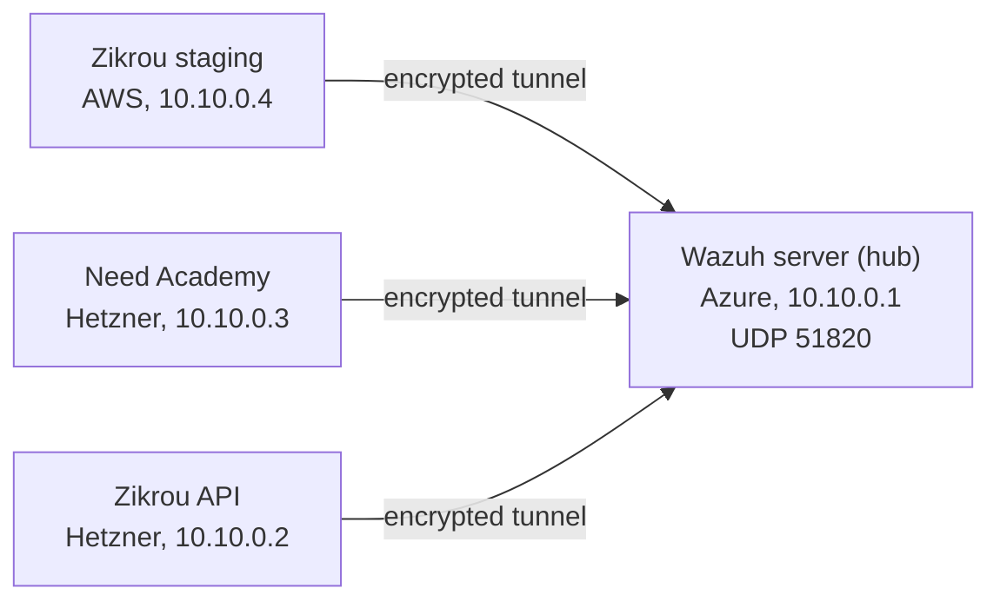
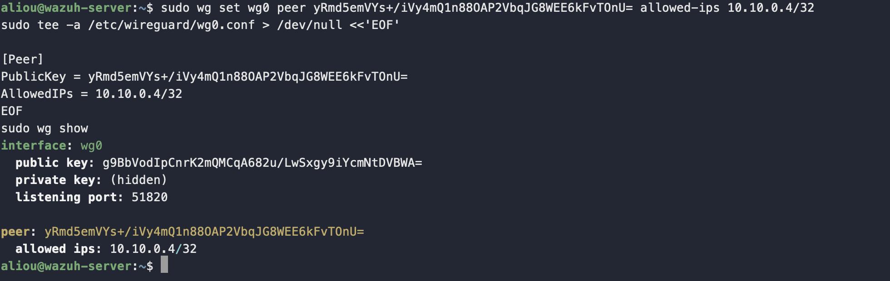
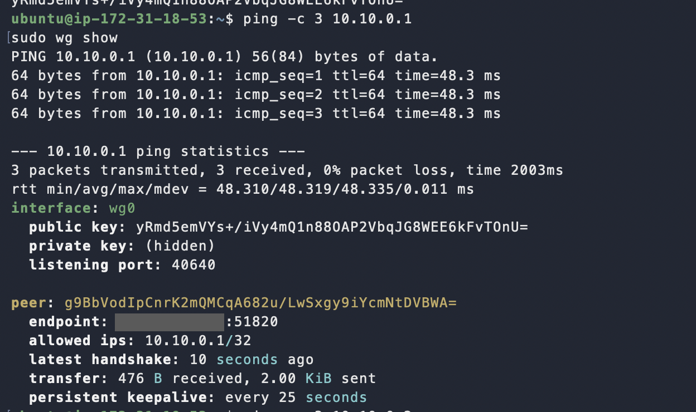
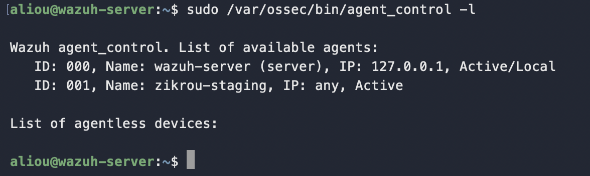
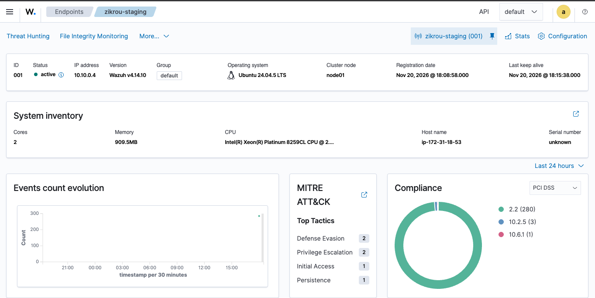
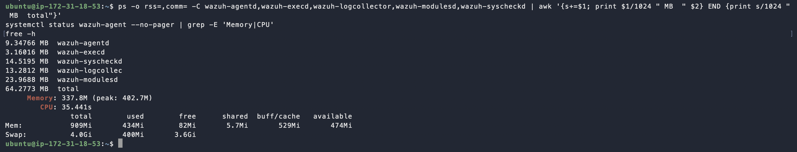
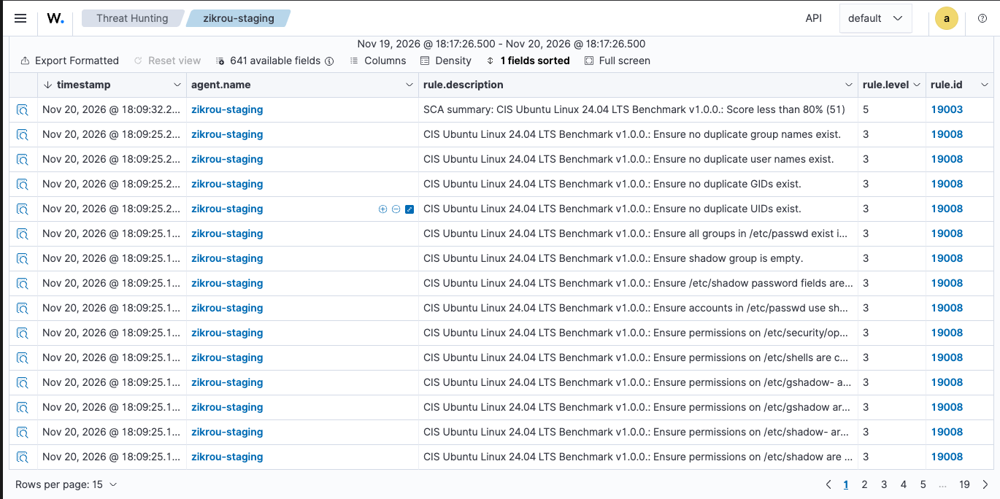
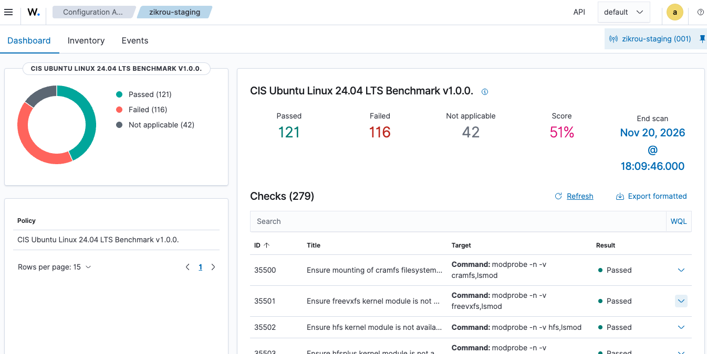
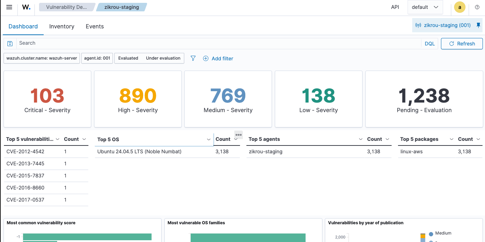
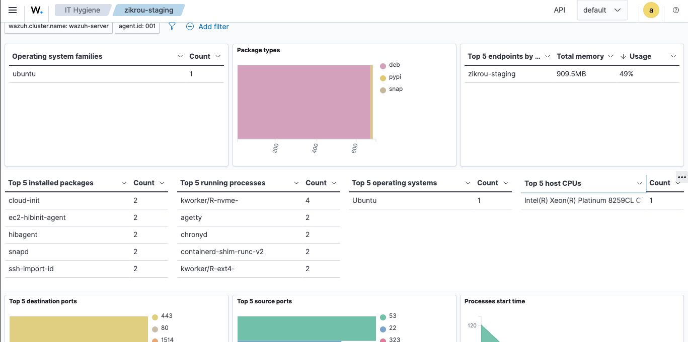

# 03: Private network with WireGuard

**Date:** 2026-11-20
**Goal:** connect the monitored servers to the Wazuh server through an encrypted private network, so that no Wazuh port is ever exposed to the internet.

## 1. Why a private network

Wazuh agents send their events to the manager on TCP 1514 and enroll on TCP 1515. Exposing these ports to the internet would let anyone probe the SIEM, try to enroll fake agents, or attack the manager directly.

Instead, every monitored server joins a WireGuard tunnel, and the Wazuh ports are only reachable **inside** that tunnel.

## 2. Design

**Hub and spoke.** The Wazuh server is the hub. Each monitored server is a spoke that connects to the hub only.

| Host | Tunnel IP | Status |
|---|---|---|
| Wazuh server (hub) | 10.10.0.1 | Up |
| Zikrou API (production) | 10.10.0.2 | **Connected** (see [report 06](06-production-onboarding.md)) |
| Need Academy | 10.10.0.3 | **Connected** (see [report 08](08-need-academy-onboarding.md)) |
| Zikrou staging | 10.10.0.4 | **Connected** |

## 3. Security properties

| Property | How it is achieved |
|---|---|
| **Strong cryptography** | Each machine has a Curve25519 key pair. Only public keys are exchanged. |
| **No identity spoofing** | WireGuard's "cryptokey routing": each peer is bound to one key and one tunnel IP (`AllowedIPs = 10.10.0.4/32`). A packet claiming to be `10.10.0.4` but not encrypted with that peer's key is dropped. |
| **Least privilege between servers** | Each spoke has `AllowedIPs = 10.10.0.1/32`: it can reach the hub only. A compromised spoke cannot use the tunnel to reach another monitored server. Only SIEM traffic goes through the tunnel; the application's normal traffic is untouched. |
| **Invisible service** | WireGuard never answers a packet that is not signed by a known key. A port scan of UDP 51820 sees nothing. |
| **Wazuh ports bound to the tunnel** | UFW allows TCP 1514 and 1515 **only on the `wg0` interface**. Even if the cloud firewall were opened by mistake, the agent ports would remain unreachable from the internet. |
| **Private keys never in config files** | Keys are generated with `umask 077` (readable by root only from the moment they are written) and loaded at startup through `PostUp = wg set %i private-key <file>`. The config files contain no secret and are versioned in this repository. |
| **No accidental key leak** | Peers are added to the hub with `wg set` (live) plus an append to `wg0.conf` (persistent). `wg-quick save` is deliberately avoided because it would write the hub's private key into the config file. |
| **NAT resilience** | `PersistentKeepalive = 25` on the spoke keeps the tunnel open through cloud NAT, which would otherwise forget an idle connection. |

## 4. Firewall changes on the hub

Two layers, both updated:

- **Azure NSG:** new inbound rule `Allow-WireGuard`, UDP 51820, priority 310.
- **UFW:** `51820/udp` allowed, and `1514,1515/tcp` allowed **on wg0 only**.

See [`configs/ufw/wazuh-server-rules.sh`](../configs/ufw/wazuh-server-rules.sh).

The line `1514,1515/tcp on wg0` is the key result: the agent ports exist, but only inside the tunnel.

## 5. Steps

### Hub

WireGuard installed, key pair generated, interface `wg0` started and enabled at boot.

See [`configs/wireguard/hub-wg0.conf`](../configs/wireguard/hub-wg0.conf).

### First spoke: Zikrou staging

Staging was chosen first because a mistake there has no impact on users.

**Before installing anything, the server was patched.** The login banner showed 34 pending updates and `System restart required` (a kernel update). After `apt full-upgrade` and a reboot, the kernel moved from `7.0.0-1014-aws` to `7.0.0-1018-aws` with 0 pending updates. A machine joining the SOC should not start with known unpatched flaws.

WireGuard was then installed and configured on the spoke. See [`configs/wireguard/spoke-staging-wg0.conf`](../configs/wireguard/spoke-staging-wg0.conf).

### Registering the spoke on the hub

The spoke's public key was added to the hub, live and in the config file:

This screenshot was taken right after the peer was added, before the first handshake, which is why no handshake line appears yet.

## 6. Verification

From staging, through the tunnel:

- `ping 10.10.0.1`: 3 packets sent, 3 received, 0% loss, about 48 ms (Stockholm to Spain).
- `latest handshake: 10 seconds ago`: the encrypted session is established.
- `persistent keepalive: every 25 seconds`: the tunnel will stay open while idle.

The hub's public IP is masked in the screenshot.

## 7. Observations on the staging server

Reading the login banner like an analyst:

| Observation | Meaning | Action |
|---|---|---|
| 34 updates, restart required | Server behind on patches | Patched and rebooted before joining the SOC |
| Disk at 72% of 18 GB | Little headroom; Docker images are a likely cause | Old kernel packages removed; monitor disk usage |
| RAM at 64%, swap in use | Small, busy instance | The Wazuh agent is light enough, but resource use will be checked after install |
| Last logins from two different IPs | Both were my own connections, from different networks | Confirms my home IP is dynamic, so SSH cannot simply be restricted to one IP |

## 8. Residual risks

| Risk | Current state | Next improvement |
|---|---|---|
| NSG rule for UDP 51820 open to any source | WireGuard ignores unknown peers | Restrict the source to the spokes' fixed IPs |
| Staging's public IP may change on stop/start | Not an issue for the tunnel (the spoke initiates) | Attach an Elastic IP before restricting the NSG |
| The hub is a single point of failure | Agents buffer events while disconnected | Acceptable for a lab; document recovery steps |
| No key rotation yet | Keys are new | Define a rotation procedure |

## 9. First agent: Zikrou staging

### Enrollment with a password

By default, the Wazuh manager enrolls any agent that reaches TCP 1515. The tunnel already limits who can reach that port, but an **enrollment password** was added as a second lock: a random 48-character secret in `/var/ossec/etc/authd.pass` (owner `root:wazuh`, mode `640`), with `<use_password>yes</use_password>` in the manager configuration.

The agent was installed from Wazuh's signed APT repository, pointed at the manager's **tunnel address** (`10.10.0.1`), and the package was put on hold (`apt-mark hold wazuh-agent`) so a routine upgrade can never make the agent newer than the manager.

The agent first appeared as `Pending` (enrolled, waiting for its first keepalive), then `Active` within a minute:

The dashboard confirms the agent reports from its **tunnel IP, 10.10.0.4**: its traffic goes through WireGuard, not the internet.

### Measured overhead on a 1 GB server

Staging is the smallest monitored server (909 MiB of RAM). systemd reported **338 MB** for the agent, which looked alarming. Measuring the real resident memory of each process told a different story:

| Process | Role | RSS |
|---|---|---|
| wazuh-modulesd | SCA, inventory, package scan | 24 MB |
| wazuh-syscheckd | File integrity monitoring | 15 MB |
| wazuh-logcollector | Log reading | 13 MB |
| wazuh-agentd | Encrypted link to the manager | 9 MB |
| wazuh-execd | Active response | 3 MB |
| **Total** | | **64 MB** |

The systemd figure includes about 270 MB of **page cache** from the agent's initial scans, which the kernel frees on demand. CPU usage flattened once the scans finished. **Conclusion:** about 7% of RAM on the most constrained server, no tuning needed. **Lesson:** a metric is only useful once you know exactly what it measures.

### First data

Within minutes, the agent produced its first events: the CIS benchmark results.

Rule IDs observed: **19003** (SCA summary, level 5), **19007** (check failed, level 7), **19008** (check passed, level 3).

**CIS score: 51%** (121 passed, 116 failed, 42 not applicable). This is the baseline to improve.

**Vulnerability detection** reported 103 critical, 890 high and 769 medium findings, plus 1,238 pending evaluation.

These numbers must not be taken at face value. **All 3,138 findings come from a single package, `linux-aws`** (the kernel), and the top CVEs date from 2012 to 2017, while the server runs a 2026 kernel freshly patched the same day. Matching kernel packages against CVE databases is a well-known source of false positives in vulnerability scanners. Triage plan: list the installed kernel packages, remove obsolete ones, and check a sample of the critical CVEs against the Ubuntu security tracker before drawing conclusions.

**IT hygiene** shows memory use at 49%, Debian packages plus a few Python and snap packages, and Docker running (`containerd-shim-runc-v2`). Outbound traffic goes to 443, 80 and **1514**, the Wazuh agent port, through the tunnel.

## 10. Next step

Collect the application logs on staging (Caddy and the Spring Boot API running in Docker), which the agent cannot see yet.
