# 04: Web logs and custom detections

**Date:** 2026-11-20
**Goal:** make the SOC see attacks against the application itself, not only against the server, by collecting the web server's logs and writing detection rules for them.

## 1. Discovery: where do the web logs live?

The Wazuh agent on staging already watched the system (SSH, sudo, packages, files), but not the application. Before changing anything, the staging server was inspected with read-only commands.

| Observation | Meaning |
|---|---|
| Docker runs only two containers: the Spring Boot API and PostgreSQL | Caddy is not containerized |
| `systemctl is-active caddy` returns `active`, Caddy listens on 80 and 443 | Caddy runs directly on the host, in front of the API |
| The API listens on `127.0.0.1:8080` only | **Positive finding:** the API cannot be reached from the internet except through Caddy |
| The Caddyfile in the repository has `log` blocks, but `/etc/caddy/Caddyfile` on staging does not | The repository file is production's; staging runs a different configuration |

## 2. Finding: staging had no web access logs

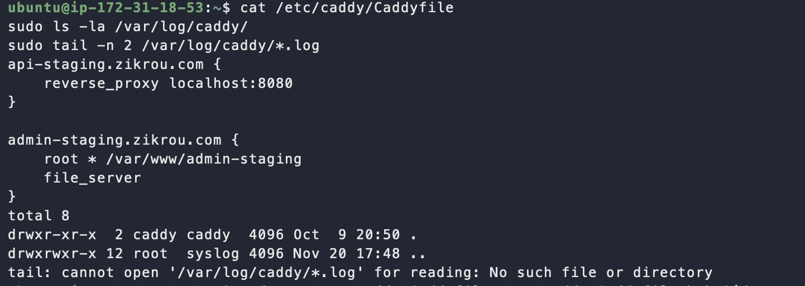

Caddy does not record HTTP requests unless configured to. On staging, `/var/log/caddy/` was empty: **an attack against the staging API would have left no trace.** This is a monitoring blind spot.

A second, related finding: staging's Caddy configuration **differs from production's** (no access logs, no security headers). This config drift matters for the upcoming penetration test, whose results are only valid if staging mirrors production. The security headers will be aligned in a later step.

## 3. Fix: enable JSON access logs

See [`configs/caddy/Caddyfile.staging`](../configs/caddy/Caddyfile.staging).

- One JSON log file per site, in `/var/log/caddy/`.
- **Rotation:** a new file every 10 MiB, 5 files kept. The staging disk is already at 74%, so logs must never be able to fill it.
- Process: backup of the existing file, `caddy fmt`, then `caddy validate ... && systemctl reload caddy`. The reload only runs if validation succeeds, and a reload applies the change with no downtime.

**Process lesson.** The first attempt left a rollback command (`cp` of the backup) in the normal sequence of commands. It ran after a successful validation and silently restored the old configuration. The second attempt chained validation and reload with `&&` and kept the rollback out of the normal path.

The first logged request:

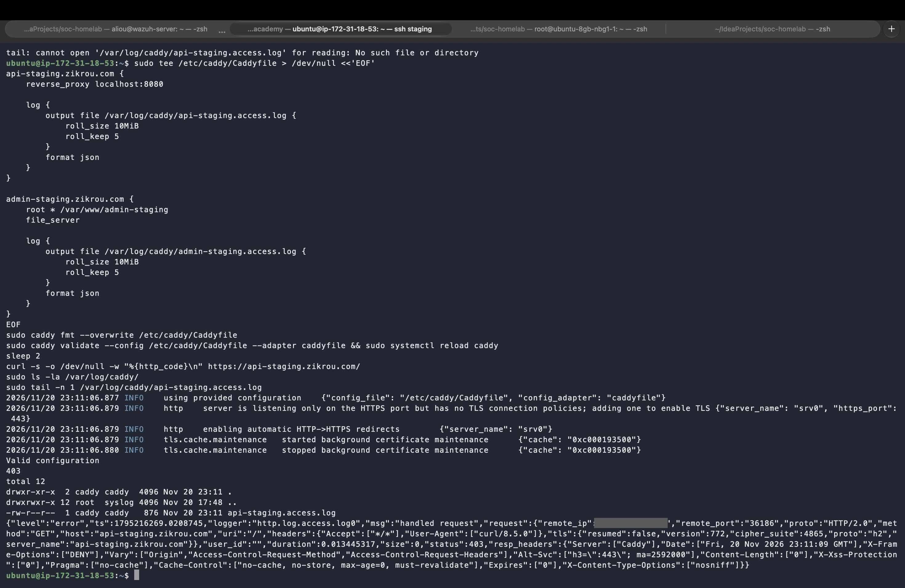

Fields that matter for detection: `request.remote_ip`, `request.method`, `request.uri`, `request.headers.User-Agent`, `status`. Caddy logs every 4xx and 5xx response with `"level":"error"`; this does not mean Caddy itself failed. The response headers also show that Spring Boot adds its own protections (`X-Frame-Options: DENY`, `nosniff`, `no-store`).

## 4. Collection by the agent

See [`configs/wazuh/agent/staging-localfile-caddy.xml`](../configs/wazuh/agent/staging-localfile-caddy.xml).

Each log file is declared as a `json` source, with a `log_source` label to tell sources apart in searches.

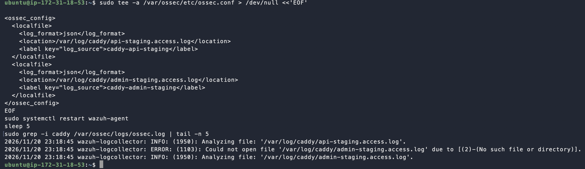

The error on `admin-staging.access.log` is expected: Caddy only creates a site's log file on its first request. The agent keeps checking and picks the file up once it exists.

## 5. How Wazuh read the logs before any custom rule

`wazuh-logtest` replays a log line through the three analysis stages without waiting for real traffic.

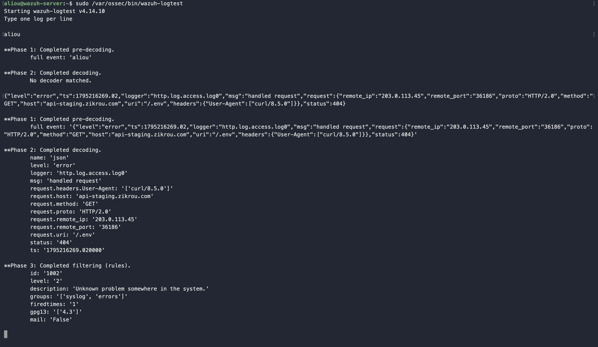

- **Decoding worked:** the built-in JSON decoder extracted every field.
- **Classification did not:** a probe for `/.env` matched rule **1002**, *"Unknown problem somewhere in the system"*, level 2. The generic rule reacted to the word `error` in Caddy's `level` field, not to what the request meant. At level 2 it was not even stored.

## 6. Custom detection rules

See [`configs/wazuh/rules/caddy_rules.xml`](../configs/wazuh/rules/caddy_rules.xml).

A parent rule recognizes any Caddy request; child rules each look for one behavior. Wazuh keeps the first child that matches, so the most specific rules come first.

| Rule | Detects | Level | MITRE ATT&CK |
|---|---|---|---|
| 100200 | Parent: any Caddy request | 0 (not stored) | |
| 100210 | Probes for secrets or admin pages: `/.env`, `/.git`, `/.aws`, `wp-admin`, `phpmyadmin`, `/actuator`... | 10 | T1595.003 Wordlist Scanning |
| 100211 | Injection or traversal in the URL: `union select`, `sleep(`, `'`, `../`, `<script` (plain and URL-encoded) | 10 | T1190 Exploit Public-Facing Application |
| 100212 | Known attack tools in the User-Agent: sqlmap, nikto, nmap, gobuster, ffuf, nuclei... | 8 | T1595 Active Scanning |
| 100201 | Any other 4xx response | 3 | |
| 100220 | **Correlation:** 20 client errors from the same IP within 60 seconds | 10 | T1595.003 Wordlist Scanning |

`/actuator` is included because it is the Spring Boot management endpoint: attackers look for it on Java APIs because an exposed `/actuator/env` can leak configuration and secrets.

### Deployment safeguards

Rules are tested with `wazuh-analysisd -t` before restarting the manager, chained with `&&`. The first version was rejected:

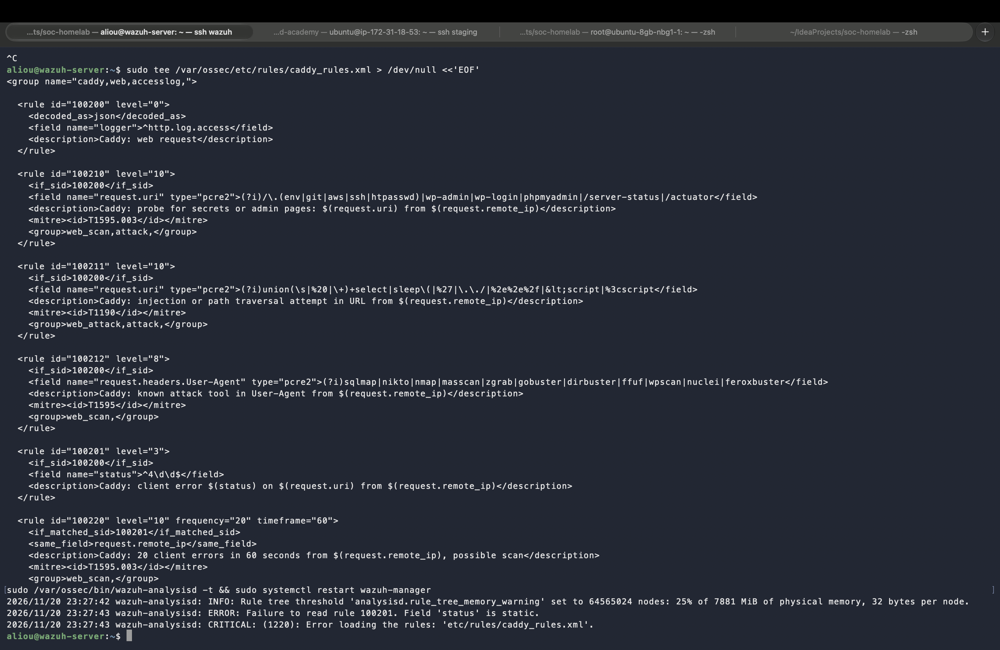

`status` is a **static field** in Wazuh (like `srcip`, `user` or `url`): it cannot be matched with `<field name="status">` and has its own `<status>` tag. Because of the `&&`, the manager never restarted with a broken ruleset.

### Validation with logtest

| Test line | Expected | Result |
|---|---|---|
| `GET /.env`, status 404 | 100210 | ✅ 100210, level 10, mapped to Reconnaissance / Wordlist Scanning |
| User-Agent `sqlmap/1.8` | 100212 | ✅ 100212, level 8, mapped to Reconnaissance / Active Scanning |
| Normal `GET /api/zikrs`, status 200 | 100200, nothing stored | ✅ 100200, level 0 |

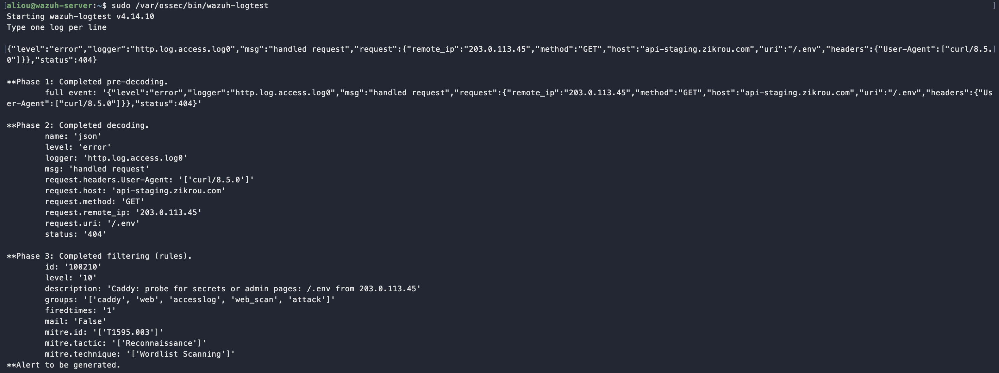

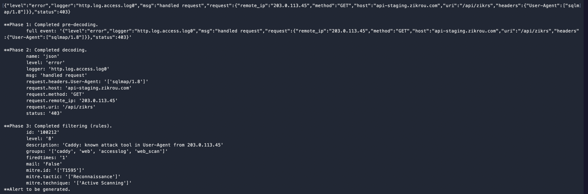

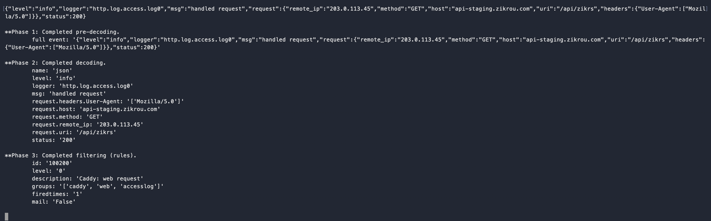

## 7. Purple team test 1: a real attack from outside

Attacks were sent from my laptop against the staging API, then checked in the dashboard.

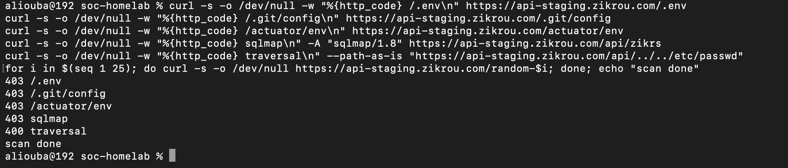

| Attack | HTTP response | Detection |
|---|---|---|
| `GET /.env` | 403 | ✅ 100210 |
| `GET /.git/config` | 403 | ✅ 100210 |
| `GET /actuator/env` | 403 | ✅ 100210 |
| `sqlmap` User-Agent | 403 | ✅ 100212 |
| Path traversal `/api/../../etc/passwd` (`--path-as-is`) | 400 | ✅ 100211 |
| 25 requests to non-existent pages | 403 | ❌ **No alert** |

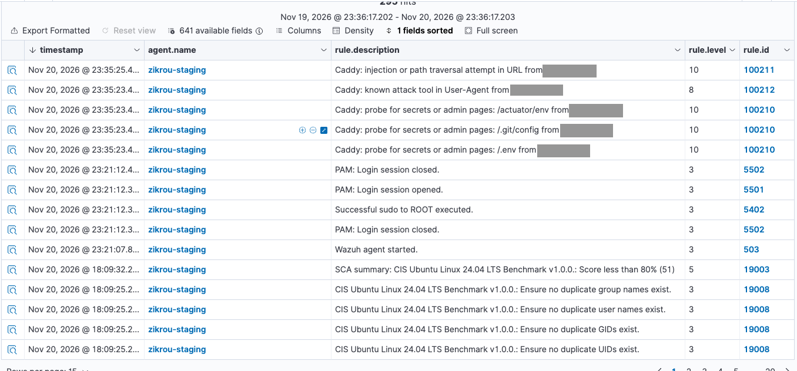

**Positive pentest observation:** `/actuator/env` returns 403. The Spring Boot management endpoint is not exposed publicly.

### False negative found and fixed

The scan was not detected: no 100201 alerts, so the correlation rule could not fire. The logtest validation had only used lines that matched a more specific rule first, so rule 100201 had never been exercised.

**Cause:** for static fields such as `<status>`, Wazuh uses a simplified matcher by default, which does not support `\d`. The pattern `^4\d\d$` therefore never matched. **Fix:** `<status type="pcre2">^4\d\d$</status>`, the full regex engine already used by the other rules.

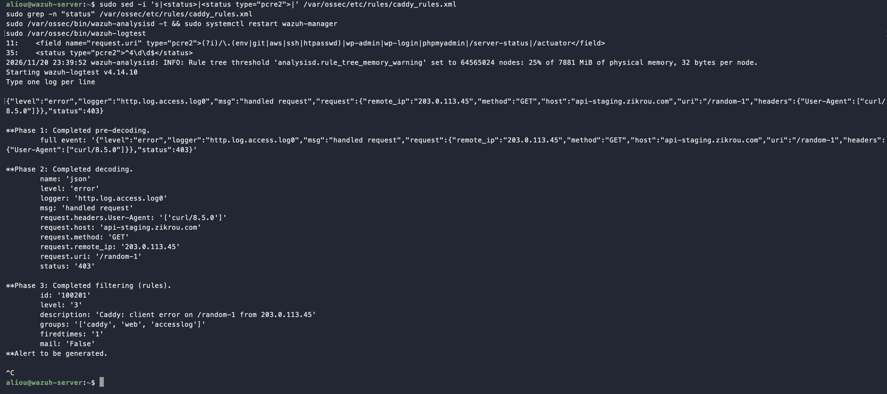

**Retest:** the same 25-request scan produced a 100201 alert per request and the correlation alert 100220, *"20 client errors in 60 seconds ... possible scan"*.

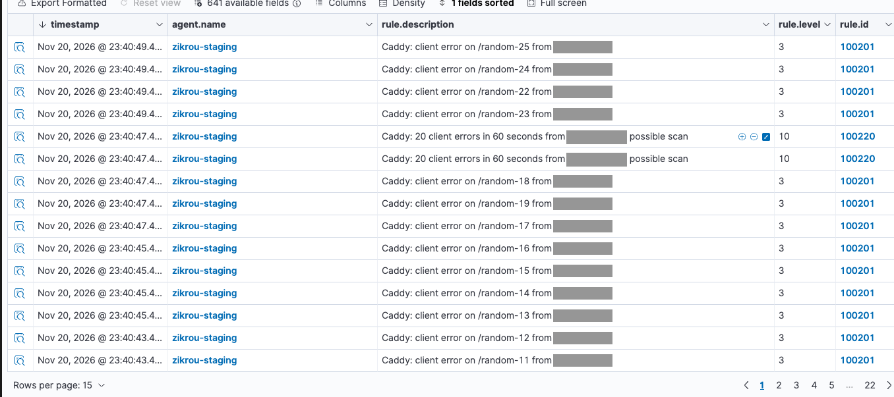

### Tuning: duplicate correlation alert

The correlation rule fired **twice** for a single scan, because requests 20 and 21 both met the threshold. An analyst would see two alerts for one event. **Fix:** `ignore="60"` on rule 100220, so after firing it stays silent for 60 seconds for that scan. Less noise, same coverage.

The source IP is masked in the screenshots.

## 8. Lessons learned

1. **Test every rule, including the generic ones.** A rule that never fires in testing is not proven to work.
2. **Validate before reloading, and chain the steps.** `caddy validate && reload` and `wazuh-analysisd -t && restart` both protected a running service from a bad change.
3. **Keep rollback commands out of the normal path.**
4. **A generic rule can mislabel an event.** Rule 1002 matched a word, not a meaning. Custom detections are needed for each application log format.

## 9. Limitations of these rules

| Limitation | Effect | Possible improvement |
|---|---|---|
| Caddy logs the URL, not the request body | Injections sent in a POST body are invisible here | Application-level logging in Spring Boot |
| Regex detection can be evaded | Unusual encodings or obfuscation may slip through | Add patterns as new evasions are tested; decode before matching |
| The User-Agent is chosen by the client | A careful attacker removes the tool name | Rely on behavior (rule 100220) rather than identity |
| Correlation only counts generic errors | Requests caught by 100210 or 100211 are not counted in 100220 | Correlate on the `caddy` group instead of a single rule |

## 10. Next steps

- Align staging's security headers with production (config drift).
- Application logs from Spring Boot: failed logins and token misuse, with a custom decoder.
- Deploy the same collection and rules to Need Academy and Zikrou production.
