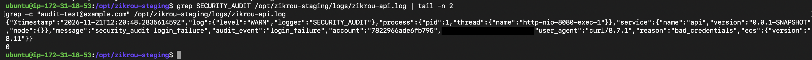
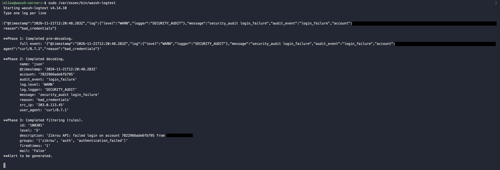
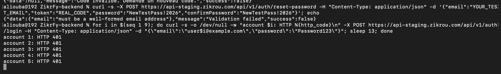
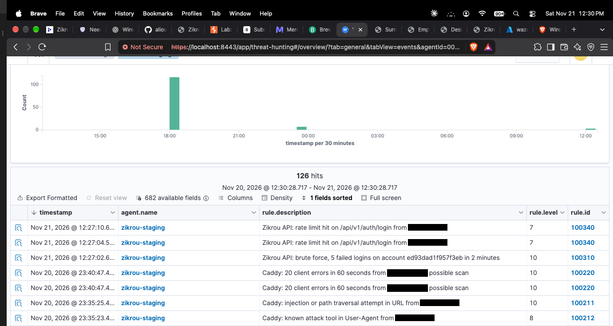
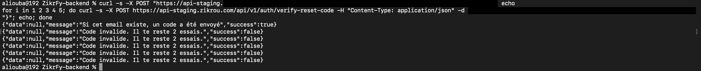
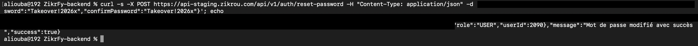
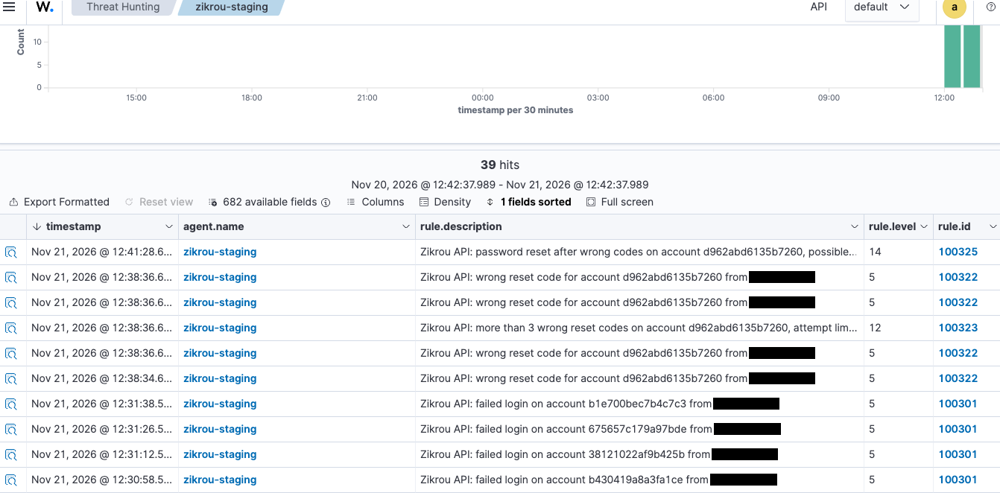
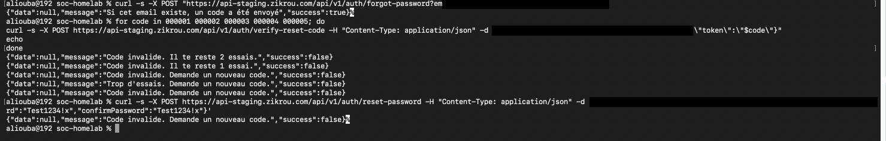
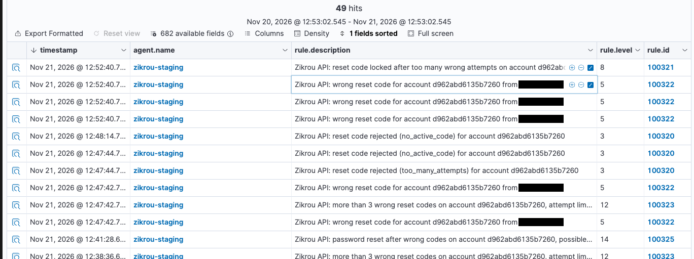

# 05: API security logs, auth detections, and a critical vulnerability

**Date:** 2026-11-21
**Goal:** make the SOC see attacks on the application's authentication (logins, password reset, tokens), then attack it from outside to prove the detections work.

**Result:** every attack was detected. The tests also uncovered a **critical vulnerability**: the password reset code had no working attempt limit, which allowed a full account takeover. It was exploited on staging, fixed, retested, and the fix is now in production.

## 1. Why web logs were not enough

Phase 04 collected Caddy's access logs. Caddy sees the URL and the status code, but not what happened inside the application:

| Question | Caddy log | Application log |
|---|---|---|
| Was this `401` on `/login` a wrong password? | No, only "401" | Yes |
| Which account was targeted? | No, the email is in the request body | Yes |
| Was a reset code wrong, expired, or locked? | No, always "400" | Yes |
| Was a refresh token revoked or expired? | No | Yes |

Detecting brute force, credential stuffing or reset code guessing needs **events emitted by the application itself**.

## 2. Security audit logging in the Spring Boot API

A dedicated logger, `SECURITY_AUDIT`, writes one structured event per security decision. The code lives in the application repository, on a `staging` branch that production does not deploy.

| Event | Emitted when | Level |
|---|---|---|
| `login_success` / `login_failure` | Every login attempt | INFO / WARN |
| `register_duplicate` | Registration with an email that already has an account | WARN |
| `reset_code_requested` | Forgot-password request | INFO |
| `reset_code_failure` | Wrong, expired, missing or locked reset code (`reason` field) | WARN |
| `password_reset_success` | Password changed through a reset code | INFO |
| `refresh_token_failure` | Refresh token not found, revoked or expired | WARN |
| `rate_limited` | The rate limiter rejected a request (`reason` = the route) | WARN |

Each event carries the same fields: `audit_event`, `account`, `src_ip`, `user_agent`, `reason`.

### Privacy by design

A SIEM stores data for a long time and many people may read it. Personal data does not belong there.

- **`account` is a fingerprint, not an email:** the first 8 bytes of a SHA-256 hash of the lowercased email. The same user always gets the same fingerprint, so detections can still count attempts per account, but the log does not reveal who the user is.
- **Existing log lines that printed emails were changed** to print the user ID instead.
- **A log line that printed the email verification token was removed.** Anyone reading that log could have verified someone else's email.
- **The user agent is truncated** to 200 characters, so an attacker cannot flood the log with a huge header.

Verification: after test requests, a search for the test email in the log file returned **0** matches.



### Real client IP

The API sits behind Caddy, so without configuration every request would appear to come from `127.0.0.1`. `server.forward-headers-strategy=native` makes the application trust `X-Forwarded-For` **only from the proxy**, so `src_ip` is the real client.

### Log output

Logs are written as JSON in the ECS format (Elastic Common Schema), set through environment variables in the staging compose file, with rotation at 10 MB and 5 files kept. See [`configs/zikrou-api/staging-logging.env`](../configs/zikrou-api/staging-logging.env).

The log folder is mounted from the container to the host, where the Wazuh agent reads it: [`configs/wazuh/agent/staging-localfile-zikrou-api.xml`](../configs/wazuh/agent/staging-localfile-zikrou-api.xml).

## 3. Detection rules

File: [`configs/wazuh/rules/zikrou_auth_rules.xml`](../configs/wazuh/rules/zikrou_auth_rules.xml), group `zikrou,auth`.

A parent rule (100300) keeps only lines whose logger is `SECURITY_AUDIT`. Child rules classify each event, and correlation rules look for patterns over time.

| Rule | Logic | Level | ATT&CK |
|---|---|---|---|
| 100301 | Failed login | 5 | |
| 100310 | 5 failed logins on **the same account** in 2 minutes | 10 | T1110.001 Password Guessing |
| 100311 | 8 failed logins from **the same IP** on **different accounts** in 5 minutes | 12 | T1110.004 Credential Stuffing |
| 100312 | Successful login on an account that was just brute-forced | 13 | T1110 |
| 100322 | Wrong reset code | 5 | |
| 100321 | Reset code locked after too many wrong attempts | 8 | T1110.001 |
| 100323 | Repeated wrong reset codes on one account in 15 minutes | 12 | T1110.001 |
| 100325 | **Password reset right after wrong codes** on the same account | 14 | T1098 Account Manipulation |
| 100330 | Use of a revoked refresh token | 10 | T1550.001 Application Access Token |
| 100340 | Rate limit hit | 7 | |
| 100351 | 5 registrations with existing emails from one IP | 8 | T1589.002 Email Addresses |

Two Wazuh options carry most of the logic:

- `same_field` and `different_field` decide **what is counted together**. Brute force is many tries on one account; credential stuffing is one IP trying many accounts.
- `if_matched_sid` links two different events. Rule 100325 only fires if a password reset succeeds **after** rule 100323 matched for the same account: the signature of a guessed code.

Each rule was first validated with `wazuh-logtest` on real log lines:



## 4. Purple team test 2: attacks on authentication

All attacks were sent from my laptop to the staging API.

### Brute force and credential stuffing

| Attack | Result | Detection |
|---|---|---|
| Repeated wrong passwords on one account | 401, then 429 from the rate limiter | 100301, **100310** (brute force), 100340 (rate limit) |
| 9 accounts, 1 wrong password each, from one IP, spaced to avoid the rate limiter | 401 for each | 100301 per attempt, **100311** (credential stuffing) |





The rate limiter alone does not stop credential stuffing: a slow attacker stays under the limit. The correlation rule on the source IP catches it anyway.

### Password reset abuse: the vulnerability

The reset flow sends a 6-digit code by email and promises **3 attempts per code**. I requested a code for a test account and sent 5 wrong codes:



**Every answer said "2 attempts left".** The limit never applied. With the real code, the password was changed and the API returned new tokens:



On a real account, an attacker who knows the victim's email can guess codes until one works. The only brakes were the code's expiry and the per-IP rate limiter, and spreading requests over many IPs removes the second one.

**Detection worked:** the SIEM showed the whole story, from the failed logins to the account takeover alert at level 14.



There are 4 alerts 100322 for 5 wrong codes because Wazuh assigns each event to **one** rule. The 5th wrong code triggered the correlation, so it appears as 100323 instead of a 5th 100322.

## 5. Root cause and fix

The method that checks the code did increment the failed-attempt counter and save it. Then it threw an exception to return "wrong code". In Spring, an unchecked exception thrown inside a `@Transactional` method **rolls back the whole transaction**, including the counter that was just saved. Every wrong attempt started again from zero.

The fix tells Spring to commit, not roll back, when that specific exception is thrown:

```java
@Transactional(noRollbackFor = BadRequestException.class)
public void verifyResetCode(String email, String code) { ... }

@Transactional(noRollbackFor = BadRequestException.class)
public AuthResponse resetPassword(ResetPasswordRequest request) { ... }
```

A one-line change per method. It was committed alone, separate from the audit logging changes, so it could be shipped to production on its own.

### Retest after the fix



| Try | Before the fix | After the fix |
|---|---|---|
| 1 | 2 attempts left | 2 attempts left |
| 2 | 2 attempts left | 1 attempt left |
| 3 | 2 attempts left | Ask for a new code |
| 4 | 2 attempts left | Too many attempts (code deleted) |
| 5 | 2 attempts left | Ask for a new code |
| Real code | **Password changed** | **Refused** |

The SIEM confirms it: the attempts are still detected, the new rule 100321 flags the lockout, and **rule 100325 no longer fires**.



### Vulnerability lifecycle

| Step | Date |
|---|---|
| Found during detection testing | 2026-11-21 |
| Exploited on staging (test account) | 2026-11-21 |
| Fixed and retested on staging | 2026-11-21 |
| Reported to the production team | 2026-11-21 |
| Fixed in production | 2026-11-21 |
| Published here | After the production fix |

Production was never attacked. The details were published only once production was fixed.

## 6. Detection tuning

After the fix, rule 100323 fired on the 3rd wrong code instead of the 4th. Its 15-minute window still counted the wrong codes from the earlier test. Its description said "attempt limit bypassed", which was no longer true.

- 100323 was renamed **"repeated wrong reset codes, possible reset code guessing"**. More than 3 wrong codes can still happen legitimately across several codes, or by an attacker who keeps requesting new codes, so the rule stays useful.
- **New rule 100321 (level 8)** fires when a code is locked. The lockout is the system working, but it is also a strong sign that someone is guessing.

## 7. Other findings

Found by code review and configuration checks, reported to the production team:

| Finding | Severity | Status |
|---|---|---|
| Root SSH login allowed on the production server | High | Reported |
| Emails and a verification token written to application logs | Medium | Fixed on staging (section 2) |
| Account enumeration: `/register`, `/resend-verification` and `/verify-reset-code` reveal whether an email has an account | Medium | Reported |
| Refresh token reused and its expiry extended on each use (no rotation) | Medium | Reported |
| The rate limiter reads the client IP from the first `X-Forwarded-For` value | Low | Safe behind Caddy today; reported |

## 8. Lessons learned

1. **Detection testing finds bugs, not only alerts.** I was testing a Wazuh rule and found a critical flaw in my own code.
2. **A security counter inside a transaction that rolls back is not a security counter.** Unit tests that only check the error message would never have seen it; only a test of the 4th attempt would.
3. **Check the active filters before concluding "no results".** A leftover dashboard filter on levels 7 to 11 hid the level 12 and 14 alerts during the test.
4. **Attack from outside, like a real attacker.** One test was first run from the SIEM server itself by mistake. Its IP then shows up as the attacker in the alerts, which pollutes the evidence.
5. **Personal data does not need to be in logs to be useful.** A fingerprint gives the SOC everything it needs to correlate.

## 9. Next steps

- Same audit logging and agent on production, now that the log cleanup is ready.
- Need Academy: web and application logs, same approach.
- Fix the account enumeration and add refresh token rotation, then retest them.
