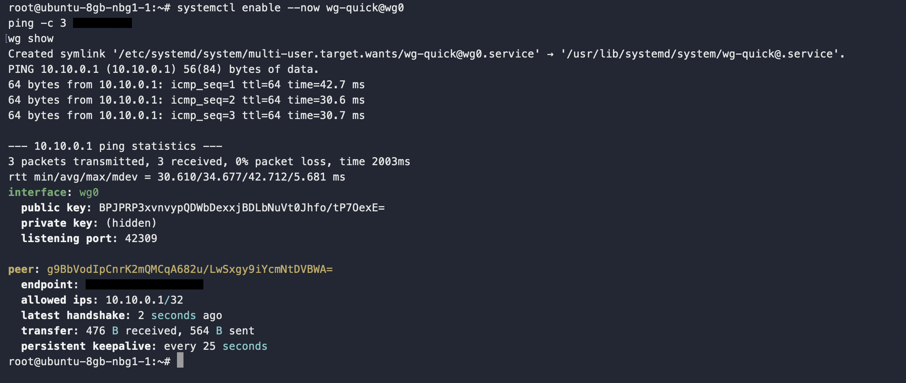
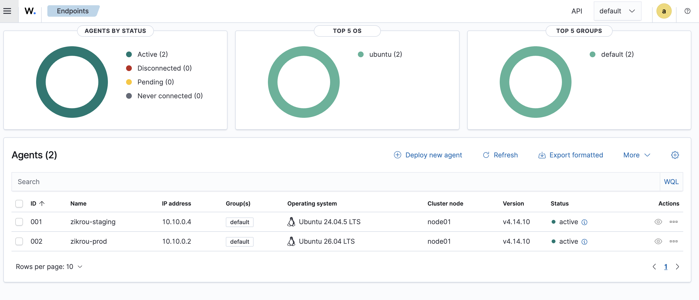
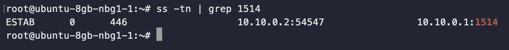
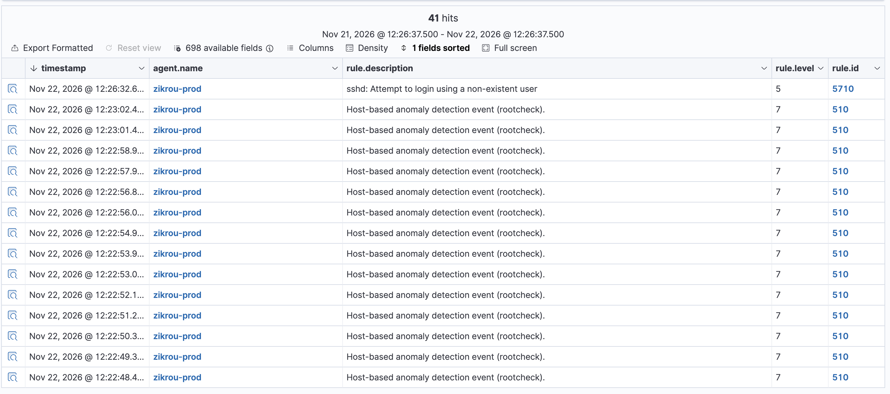
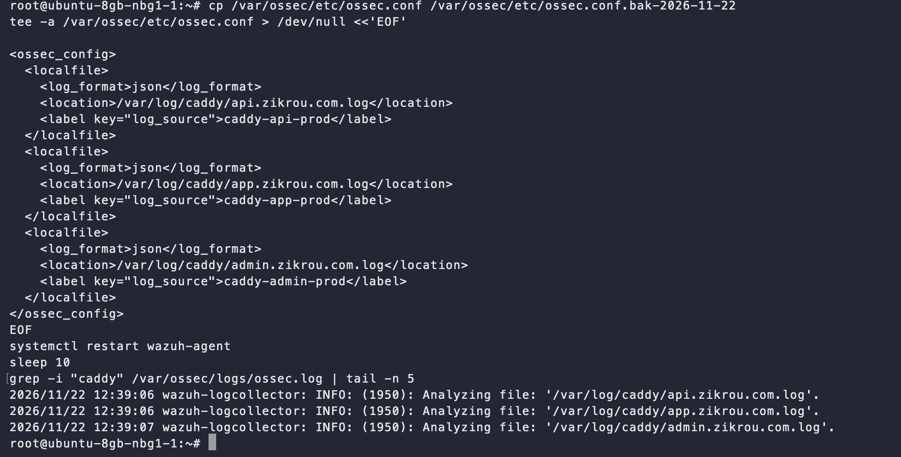

# 06: Production onboarding and first triage

**Date:** 2026-11-22
**Goal:** bring the Zikrou production server into the SOC: private tunnel, Wazuh agent, web logs. Production is only observed here, never attacked.

**Result:** production reports to Wazuh through WireGuard. Four minutes after the agent started, the SIEM raised its first real alert from the internet, which was triaged and closed.

## 1. What changes on production

Only two background services are added: WireGuard and the Wazuh agent. The application, Docker, the database and Caddy are not modified. The production team was informed.

| Item | Value |
|---|---|
| Server | Zikrou production (Hetzner, Ubuntu 26.04) |
| Tunnel IP | `10.10.0.2` |
| Agent | `zikrou-prod`, ID 002, version 4.14.10 |
| New inbound port on production | **None** |

## 2. WireGuard: production becomes a spoke

Same design as staging ([report 03](03-wireguard-network.md)):

- **The spoke opens the connection** to the hub on UDP 51820 and keeps it alive every 25 seconds. Production only sends outbound traffic, and the firewall lets the replies back, so no port is opened on production.
- `AllowedIPs = 10.10.0.1/32` on production: the tunnel carries SIEM traffic only. A compromised production server cannot use it to reach staging.
- On the hub, production is bound to its own key and to `10.10.0.2/32` only.



### Mistake and correction

The first attempt declared **the hub's own public key** as the production peer on the hub. WireGuard silently ignores a peer that has the interface's own key, so `wg show` listed staging only, and the wrong `[Peer]` block was written in the hub's config file.

Correction: remove the wrong peer from the running interface, then rewrite the hub's whole `wg0.conf` with both real peers, so staging was never interrupted.

**Rule to remember:** each side's config contains the **other side's** public key. The hub's key goes in the spoke's file, and the spoke's key goes in the hub's file.

## 3. Wazuh agent

| Choice | Reason |
|---|---|
| Agent version pinned to the manager's (`4.14.10`), then `apt-mark hold` | An agent newer than the manager is not supported. A routine `apt upgrade` must never break that match. |
| Manager address `10.10.0.1` | Agent traffic goes through the tunnel, never the internet. |
| Enrollment password given through `read -s` | The password never appears on screen nor in the shell history. |
| Signed Wazuh APT repository | Packages verified against Wazuh's GPG key. |

The agent is active, with its tunnel IP:



And the connection really goes through the tunnel (`10.10.0.2` to `10.10.0.1:1514`):



## 4. First alert from production: triage



Four minutes after the agent started, rule **5710** fired: *sshd: attempt to login using a non-existent user*. The login did not come from me, so it was triaged.

**Question to answer:** did any SSH attempt succeed?

| Check | Result |
|---|---|
| Invalid-user attempts in 24 hours | **475** |
| Top source | One IP alone made 255 attempts; the next 9 sources made between 9 and 45 each. |
| Password authentication | `passwordauthentication no`: without a private key, none of these attempts can succeed. |
| Successful logins in 24 hours | 4, all with SSH keys |

The successful logins:

| Source | Key | Verdict |
|---|---|---|
| My connection (2 IPs, 2 days) | My key | Legitimate |
| A Microsoft Azure IP in the US | A different key | **Checked:** the fingerprint matches the CI/CD deploy key, and GitHub Actions runners are hosted on Azure. The production team's remediation report confirms it independently: the deploy of the F1 fix restarted the API at 18:55:30 UTC, 1.5 minutes after this login at 18:53:57. Legitimate. |

**Verdict:** true positive (real attempts), no impact. Closed as internet background noise.

**What the triage revealed:** the CI/CD pipeline connects to production **as root**. A leaked deploy key would give full control of the server. This confirms an existing finding: create a dedicated `deploy` user with limited rights and set `PermitRootLogin no`. Reported to the production team.

**Lesson:** this traffic was there before; it was simply invisible. The SIEM did not create the noise, it revealed it. The value of the analyst is to answer the one question that matters (did anything succeed?) instead of reacting to the volume.

## 5. Production web logs

Production already writes Caddy access logs in JSON, with the same fields as staging. The detection rules written in [report 04](04-web-logs-and-custom-detections.md) apply as they are, with no change.

| Site | Log file |
|---|---|
| API | `/var/log/caddy/api.zikrou.com.log` |
| Web app (Flutter) | `/var/log/caddy/app.zikrou.com.log` |
| Admin panel | `/var/log/caddy/admin.zikrou.com.log` |

Configuration: [`configs/wazuh/agent/prod-localfile-caddy.xml`](../configs/wazuh/agent/prod-localfile-caddy.xml). The agent's config was backed up before the change.



**Volume.** Production writes about 200 MB of API access logs per day. The agent reads only new lines from the moment it starts, so the existing logs are not replayed. Only lines matching a rule become alerts.

**Validation without attacking production.** No test attack is sent to production. Internet bots probe `/.env`, `/.git/config` and admin paths on every public site; their requests are expected to trigger rule 100210 on their own.

## 6. First tuning: a false positive that revealed a bug

### Symptom

Minutes after the web logs arrived, rule **100201** (any 4xx response, level 3) fired about **100 times per minute**, around 150,000 alerts per day. Almost every alert had the same shape:

- Route: `PATCH /api/v1/zikr/{id}/progress`, which the app sends about every 70 seconds while someone listens.
- Many different source IPs, mostly Senegalese mobile and broadband networks: real users, not attackers.

An analyst cannot read 100 alerts per minute. But silencing an alert without understanding it can hide a real problem, so the cause came first.

### Investigation

| Question | Method | Result |
|---|---|---|
| Which status codes does this route return? | Count `status` on `/progress` in the last 20,000 Caddy lines | 2,569 &times; 200, **12,491 &times; 403**, 53 &times; 401 |
| What does the API require for this route? | Read `SecurityConfig` | No specific rule, so `anyRequest().authenticated()`: an account is required. `/play` and `/view` are open to guests. Without a token, Spring Security answers **403** by default (no custom `AuthenticationEntryPoint`). |
| Are the 403s guests? | Count the `Authorization` header (Caddy logs its presence, value redacted) | **0** of the 403s carry one. The 200s do. |

**Conclusion.** Listeners without an account may play audio, but the Flutter app still sends their progress, and the API correctly refuses it.

| Question | Answer |
|---|---|
| Attack? | No |
| Access control? | Works as intended: a guest cannot write progress |
| Data loss for users? | No: logged-in users' progress returns 200 |
| Bug? | Yes, functional: about 83% of progress requests are bound to fail, which wastes mobile data, battery and API capacity. The API also answers 403 where 401 is the correct code. |

Reported to the production team (finding F9) with two fixes: send progress only when logged in (app), and return 401 for unauthenticated requests (API).

### Tuning

The rule was not lowered for every 4xx. A **narrow exception** was added instead: a child rule at level 0 that only matches the three conditions together.

```xml
<rule id="100202" level="0">
  <if_sid>100201</if_sid>
  <field name="request.method">^PATCH$</field>
  <field name="request.uri" type="pcre2">^/api/v1/zikr/\d+/progress(\?|$)</field>
  <status type="pcre2">^403$</status>
  <description>Caddy: progress update from anonymous listener rejected (expected behaviour)</description>
</rule>
```

- A 401, 404 or 500 on the same route still raises an alert.
- These requests no longer count toward rule 100220 (20 errors in 60 seconds from one IP). This matters in Senegal, where many mobile users share one public IP through their carrier: a group of guest listeners would otherwise look like a scan.

**Lesson:** the noisiest alert of the day was not an attack, it was a product bug. Understanding a false positive before tuning it is what turned noise into a finding.

### Second tuning: alert on behaviour, not on single errors

After the first tuning, the volume dropped from about 100 alerts per minute to a few. The remaining 4xx showed a second pattern: one IP producing about 8 errors **in the same second**, on the routes the app calls when it opens (`/home`, `/album`, `/config`, `/users/me`, `/me/notifications`).

| Status | Routes | Cause |
|---|---|---|
| 401 | Personal **and public** routes (`/album`, `/home`, `/config`, `/zakir`, `/daira`) | The phone sends an **expired token** when the app opens. The JWT filter rejects it before checking whether the route is public. The app then refreshes the session and retries. |
| 403 | `/playlists`, `/me/notifications`, `/search/history` | Guests: the app calls personal routes without an account, the same pattern as the progress requests. Added to finding F9. |

All of it is normal user behaviour. Adding one exception per route would never end, so the design itself was changed:

- **Rule 100201 now has level 0.** A single 4xx response is never an attack on its own. The rule still exists and still feeds the correlation.
- **Rule 100220** (20 errors in 60 seconds from one IP) is what alerts, at level 10. Repetition is the signal of a scan, not a single error.
- The **targeted rules** keep alerting on the first request: secrets and admin probes (100210), injection and traversal (100211), attack tools (100212).

This is how mature detection is designed: atomic events are kept for context and correlation, and alerts are raised on behaviour.

## 7. Rootcheck events

When the agent started, the rootkit scan (rootcheck) produced 15 alerts with rule 510. They will be triaged separately: on servers running Docker, these are often false positives caused by container files.

## 8. Next steps

- Review the remaining 4xx alerts from production after a few days (401, 404) and tune where justified.
- Triage the rootcheck alerts.
- Deploy the application security audit logs to production (see [report 05](05-api-security-logs-and-reset-code-vulnerability.md)), after the production team ships the log cleanup.
