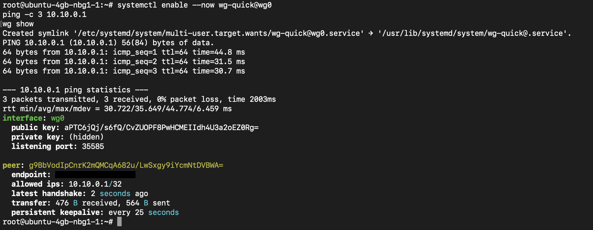
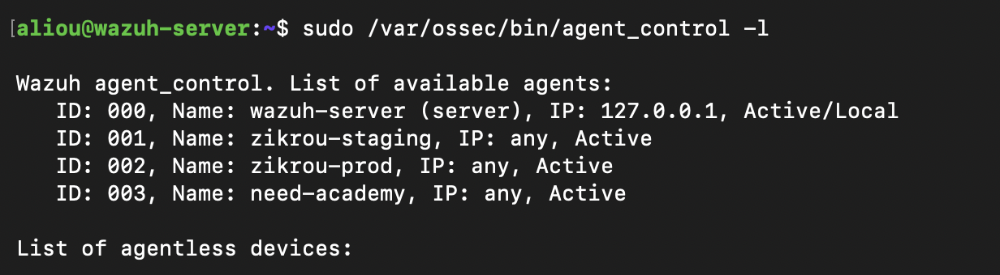
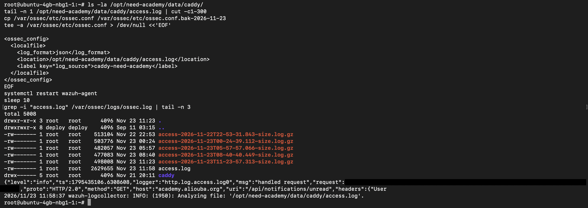
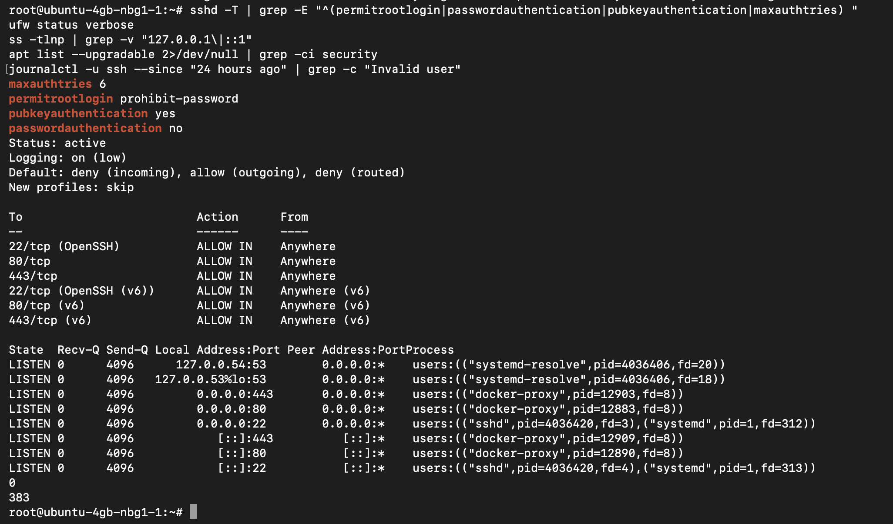

# 08: Need Academy onboarding

**Date:** 2026-11-23
**Goal:** bring Need Academy (academy.aliouba.org, about 300 users) into the SOC: private tunnel, Wazuh agent, web logs, and a security posture check.

**Result:** all three applications now report to the SIEM. The server's posture is good; three improvements were noted.

## 1. The server

| Item | Value |
|---|---|
| Application | Need Academy, English learning platform (Spring Boot, PostgreSQL) |
| Host | Hetzner Cloud, Ubuntu 26.04 |
| Runtime | Docker Compose: PostgreSQL, the application in two colours (blue/green deployment), Caddy |
| Tunnel IP | `10.10.0.3` |
| Agent | `need-academy`, ID 003, version 4.14.10 |
| New inbound port | None |

Unlike Zikrou, Need Academy is my own application end to end: findings here are mine to fix.

## 2. WireGuard

Same design as the other spokes ([report 03](03-wireguard-network.md)): the server opens the connection to the hub, `AllowedIPs = 10.10.0.1/32` keeps the tunnel to SIEM traffic only, and the hub binds the server's key to `10.10.0.3/32`.

The hub's configuration file was rewritten in full with its three peers (staging, Zikrou production, Need Academy) rather than appended to, so it always matches what is running. The new peer was added to the live interface in the same step, without interrupting the other two.

## 3. Wazuh agent

Installed exactly as on Zikrou production ([report 06](06-production-onboarding.md)): version pinned to the manager's and held, manager address on the tunnel, enrollment password entered with `read -s` so it never appears on screen or in the shell history.

## 4. Web logs from a Caddy container

Caddy runs **inside a Docker container**. A log written inside a container is invisible to an agent on the host, so the first step was to find where Caddy writes and whether the host can see it.

| Check | Result |
|---|---|
| Caddyfile, read from the container | `log { output file /data/access.log }`, rotation 10 MB, 5 files kept |
| Container mounts | `/opt/need-academy/data/caddy` on the host is `/data` in the container |
| So the log on the host is | `/opt/need-academy/data/caddy/access.log` |
| Format | JSON, the same fields as Zikrou |

The agent reads that file directly: no change to Docker, Caddy or the application. Because the format is the same, the web detection rules (100200 to 100220) apply to Need Academy without modification.

Configuration: [`configs/wazuh/agent/need-academy-localfile-caddy.xml`](../configs/wazuh/agent/need-academy-localfile-caddy.xml).

## 5. Security posture check

Read-only checks, the same as for Zikrou production.

| Check | Result | Assessment |
|---|---|---|
| SSH passwords | `passwordauthentication no` | Good: keys only |
| Root login | `permitrootlogin prohibit-password` | Acceptable: root only with a key. Better than Zikrou production (`yes`). |
| `maxauthtries` | 6 (default) | Can be lowered to 3 |
| Firewall | UFW active, deny incoming by default; 22, 80 and 443 open | Good |
| Listening ports | 22 (SSH), 80 and 443 (Caddy) | Good: PostgreSQL and the application are not exposed |
| Pending security updates | 0 (54 other updates) | Good, but a reboot is pending |
| SSH attempts with invalid users, 24 h | 383 | Internet noise; cannot succeed without a key |

Note on Docker and UFW: Docker publishes container ports through its own firewall rules, which bypass UFW. Here only 80 and 443 are published, which UFW allows anyway. Any new `ports:` entry in the Compose file would be exposed to the internet whatever UFW says.

## 6. Findings

| # | Finding | Severity | Recommendation |
|---|---|---|---|
| NA-1 | Web log retention is about 12 to 15 hours (5 files of 10 MB, rotating every 2 to 5 hours) | Medium | Keep more files (for example `roll_keep 30`), or keep by age with `roll_keep_for`. The SIEM now keeps the alerts, but not every request. |
| NA-2 | The login banner says "System restart required": a kernel update is not active yet | Low | Reboot at a quiet hour; the blue/green setup does not cover a host reboot, so expect a short outage |
| NA-3 | The `deploy` user's sudo password is not known; administration happens as root | Low | Set a new password, store it in the password manager, then administer as `deploy` and set `PermitRootLogin no` |
| NA-4 | `maxauthtries` at the default of 6 | Low | Set it to 3, as on the Wazuh server |
| NA-5 | The GitHub Actions deploy used the administrator's **personal** SSH key, stored as a repository secret. That key also opens root on Zikrou production and on Need Academy. | High | **Fixed on 2026-11-24** (section 7) |

## 7. NA-5: a personal key used by the CI/CD pipeline

**How it was found.** Building the list of legitimate SSH keys for phase 09, the `authorized_keys` of the `deploy` user held only one key: the administrator's personal key. The server's logs confirmed it: in 30 days, about 270 logins as `deploy` from some 39 Microsoft Azure IPs (GitHub Actions runners, 7 connections per deployment), all with that personal key.

**Why it mattered.** The private half of the personal key sat in the repository's secrets. That key also opens **root** on Zikrou production and on Need Academy. A leak of the GitHub secret (a malicious third-party action, a compromised account, a workflow that prints its environment) would have given full control of both production servers, not just the ability to deploy one application.

**Fix, on 2026-11-24.**

| Step | Result |
|---|---|
| Dedicated key `github-actions-need-academy-deploy` created | Fingerprint `SHA256:x3P0SOsc...` |
| Public key added to `deploy` only | The key opens nothing else |
| Repository secret `SSH_KEY` replaced with the new private key | The personal key no longer exists at GitHub |
| Deployment re-run | Green; the server logged 7 logins as `deploy` from an Azure IP, **all with the new key** |
| Local copy of the new private key deleted | It now exists only in GitHub's secrets |
| Unused secret `RENDER_DEPLOY_HOOK` deleted | Left over from the former hosting |

The administrator's personal key stays authorized on `deploy`, because it never was the problem: its copy at GitHub was. Zikrou already followed this pattern with its own dedicated deploy key.

**Remaining:** a copy of the personal private key was stored at GitHub for two months. Replacing the personal key on both production servers is recommended, as a precaution.

**Detection.** The new key was added to the allowlist of the SSH rules (phase 09), so its deployments are recognized, and any other key on `deploy` raises a level 12 alert.

## 8. Side observation: confirmation of SOC-2026-005

The login banner on this server said **"Users logged in: 0"** while I was logged in. That is the `who` command failing under its AppArmor profile on Ubuntu 26.04, which is exactly the explanation given in [SOC-2026-005](../incidents/reports/SOC-2026-005-ssh-success-after-brute-force.md) for the AppArmor denials after a login on Zikrou production. A second server, same symptom: the explanation holds.

## 9. Next steps

- Review the first web alerts from Need Academy after a few hours of real traffic, as was done for Zikrou ([report 06](06-production-onboarding.md), section 6).
- Application security audit log for Need Academy: login failures, password resets, role changes, in the same format as Zikrou's, so the authentication rules can be reused.
- Fix NA-1 to NA-4.
